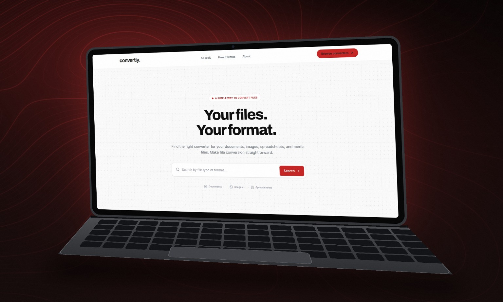

<p align="center">
  
</p>
<h1 align="center">Convertly</h1>

<p align="center">
  Simple. Fast. Convenient file conversion.
</p>

<p align="center">
  A Web-Based File Conversion Platform
</p>

<p align="center">
  
  
  
  
  
  
  
</p>

---

## About

Convertly is a web-based file conversion platform that allows users to convert files into different formats through a simple and accessible interface.

The project aims to make file conversion convenient without requiring users to create an account or go through complicated steps. Users can choose a conversion tool, upload their files, and download the converted output.

## Features

- **Multiple File Converters** — Convert files between supported formats.
- **Simple User Interface** — Clean and straightforward conversion workflow.
- **No Account Required** — Access conversion tools without registration.
- **Daily Usage Limit** — Usage limit for supported external API converters.
- **Shared Conversion Quota** — Daily usage is shared across supported converters.
- **Responsive Interface** — Designed for different screen sizes.
- **File Download** — Download converted files after processing.

## Available Converters

| Converter | Description |
|---|---|
| PDF to Word | Convert PDF documents into Word files |
| PDF to TXT | Extract text from PDF files |
| Excel to PDF | Convert Excel spreadsheets into PDF documents |
| PowerPoint to PDF | Convert PowerPoint presentations into PDF files |

More conversion tools are available within the platform.

## Daily Usage Limit

Convertly implements a device-based usage limit for supported external API converters.

| Limit | Details |
|---|---|
| Daily allowance | 3 conversions |
| Usage tracking | Per device |
| Shared limit | Shared across supported external converters |
| Reset schedule | Daily, based on Philippine time (Manila) |

## Tech Stack

### Frontend

- React
- TypeScript
- Vite
- Tailwind CSS

### Backend & Services

- Adobe PDF Services API
- Upstash Redis

### Deployment

- Vercel

## Getting Started

### Prerequisites

- Node.js
- npm

### Installation

1. Clone the repository:

   ```bash
   git clone https://github.com/Syntaxdevv/Convertly.git
   ```

2. Navigate to the project folder:

   ```bash
   cd Convertly
   ```

3. Install dependencies:

   ```bash
   npm install
   ```

4. Configure the required environment variables for the conversion services and usage tracking.

5. Start the development server:

   ```bash
   npm run dev
   ```

## Available Scripts

| Command | Description |
|---|---|
| `npm run dev` | Start the development server |
| `npm run build` | Build the project for production |
| `npm run preview` | Preview the production build locally |

## License

Permission is required from the author before copying, modifying, redistributing, or using this project or any part of its source code.

